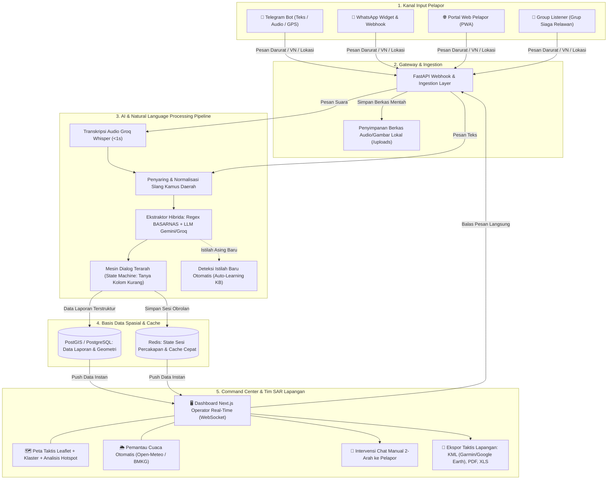

# 🚨 Lapor SAR Lite — Platform Kedaruratan & Command Center SAR Cerdas

> **Sistem Pelaporan Kondisi Marabahaya, Ekstraksi Data Otomatis Berbasis Cloud AI, dan Pusat Pengendali Operasi SAR Real-Time.**  
> *Versi 3.1.0-Lite | Arsitektur Efisien, Latensi Rendah, dan Hemat Sumber Daya (~1.5–2 GB RAM).*

---

## 📌 DAFTAR ISI

1. [Apa itu Lapor SAR Lite?](#-1-apa-itu-lapor-sar-lite)
2. [Bagaimana Sistem Bekerja?](#-2-bagaimana-sistem-bekerja)
   - [Diagram Arsitektur Sistem](#diagram-arsitektur-sistem)
   - [Alur Kerja End-to-End (Dari Warga ke Tim Rescue)](#alur-kerja-end-to-end)
3. [Fitur-Fitur Utama](#-3-fitur-fitur-utama)
4. [Struktur Direktori Proyek](#-4-struktur-direktori-proyek)
5. [Spesifikasi & Kebutuhan Sistem](#-5-spesifikasi--kebutuhan-sistem)
6. [Panduan Instalasi & Menjalankan Sistem](#-6-panduan-instalasi--menjalankan-sistem)
   - [Metode 1: Docker Compose (Rekomendasi Utama)](#metode-1-docker-compose-rekomendasi-utama)
   - [Metode 2: Quick Demo via Cloudflare Tunnel](#metode-2-quick-demo-via-cloudflare-tunnel)
   - [Metode 3: Deploy Produksi di Server Debian/Linux](#metode-3-deploy-produksi-di-server-debianlinux)
   - [Metode 4: Varian Pilot Legacy (Google Apps Script + Sheets)](#metode-4-varian-pilot-legacy-google-apps-script--sheets)
7. [Konfigurasi Environment (.env)](#-7-konfigurasi-environment-env)
8. [Panduan Penggunaan Operasional](#-8-panduan-penggunaan-operasional)
   - [Bagi Warga / Pelapor](#bagi-warga--pelapor)
   - [Bagi Operator Command Center](#bagi-operator-command-center)
   - [Bagi Administrator Sistem](#bagi-administrator-sistem)
9. [Teknologi yang Digunakan (Tech Stack)](#-9-teknologi-yang-digunakan-tech-stack)
10. [Lisensi & Kontribusi](#-10-lisensi--kontribusi)

---

## 💡 1. Apa itu Lapor SAR Lite?

**Lapor SAR Lite** adalah platform digitalisasi sistem tanggap darurat marabahaya (Search and Rescue - SAR) yang dirancang untuk menjembatani komunikasi antara masyarakat (pelapor di lapangan) dengan **Command Center BASARNAS** serta **Potensi SAR**.

Dalam situasi darurat musibah laut, kecelakaan transportasi, maupun bencana alam, masyarakat sering kali panik, menggunakan rekaman suara (*voice note*), memakai bahasa daerah setempat, atau tidak dapat menyebutkan titik koordinat dengan format baku.

**Lapor SAR Lite hadir untuk memecahkan kendala tersebut:**
- **Pemrosesan Suara Seketika:** Mentranskripsi rekaman suara (*voice note*) darurat menjadi teks dalam waktu **< 1 detik**.
- **Ekstraksi Cerdas & Kamus Bahasa Lokal:** Memahami bahasa sehari-hari, dialek daerah (Jawa, Melayu, Bugis, Sunda, dll.), serta akronim maritim, lalu merangkumnya secara otomatis menjadi data standar operasional SAR (Waktu, Lokasi/Koordinat, Jenis Musibah, Jumlah & Kondisi Korban).
- **Tanya-Jawab Interaktif Otomatis:** Mengajukan pertanyaan lanjutan secara runtut dan manusiawi apabila informasi penting dari pelapor belum lengkap.
- **Visualisasi Taktis Real-Time:** Menampilkan laporan ke peta digital Command Center dengan visualisasi klaster sebaran, kerapatan hotspot musibah, pemantauan cuaca otomatis, dan kanal obrolan manual dua arah antara operator dan pelapor.

### 🌟 Mengapa Varian "Lite"?
Varian *Lite* dirancang khusus agar dapat dijalankan pada **server berbiaya rendah (VPS 2 GB RAM)** atau **laptop presentasi lapangan** tanpa memerlukan GPU diskrit atau server MinIO mandiri yang memakan memori:
1. **Cloud AI Hybrid Engine:** Beban komputasi model AI dialihkan ke Cloud API berlatensi ultra-rendah (Groq Whisper untuk audio dan Google Gemini Flash / Llama 3.3 untuk penalaran teks).
2. **Local Storage Engine:** Penyimpanan foto laporan, voice note, dan peta statis disimpan langsung ke direktori lokal terproteksi (`/uploads`), menggantikan ketergantungan pada cluster object storage eksternal.
3. **Zero Port Exposure:** Terintegrasi langsung dengan Cloudflare Tunnel untuk menghasilkan tautan HTTPS aman tanpa perlu membuka port router atau memiliki IP publik statis.

---

## ⚙️ 2. Bagaimana Sistem Bekerja?

Sistem Lapor SAR Lite menghubungkan kanal komunikasi pesan instan publik dengan pusat komando operasi melalui rantai pemrosesan otomatis berbasis AI.

### Diagram Arsitektur Sistem



---

### Alur Kerja End-to-End

#### Tahap 1: Pengiriman Laporan oleh Masyarakat
Pelapor mengirimkan pesan darurat melalui **Telegram Bot**, **WhatsApp**, atau **Web Portal**. Bentuk laporan dapat berupa:
- Teks bebas (contoh: *"Lapor, ada pompong nelayan tenggelam di perairan karang karimun, 3 orang masih hilang"*).
- Pesan suara / *Voice Note* (format OGG/OPUS).
- Titik koordinat GPS langsung (*Share Location*) atau penandaan lokasi via *Webview Map Picker*.

#### Tahap 2: Transkripsi & Normalisasi Dialek
1. Jika berupa suara, sistem menyimpannya ke storage lokal dan mengirimkan aliran audio ke **Groq Whisper Large-V3** (atau OpenAI Whisper). Teks transkrip bahasa Indonesia didapatkan kembali dalam tempo **< 1 detik**.
2. Teks disaring melalui modul **AutoCorrect & Kamus Daerah** (`seed_dictionary.py`) untuk mengenali istilah slang maritim atau kata daerah (contoh: *"pompong"* = perahu kayu bermesin, *"lindu"* = gempa bumi, *"bale"* = balai desa).

#### Tahap 3: Ekstraksi Data Hibrida (Hybrid NLP)
Modul `nlp_extractor.py` memproses pesan menggunakan dua lapisan kecerdasan:
1. **Rule-Based Engine (Regex Pola SAR):** Memeriksa pola koordinat derajat/menit/detik, desimal, format jam, dan kata kunci korban untuk efisiensi instan.
2. **LLM Inference Fallback (Gemini 1.5 Flash / Groq Llama 3.3):** Jika informasi tersebar dalam kalimat kompleks, LLM mengekstrak atribut penting:
   - **Jenis Kedaruratan:** Kecelakaan Kapal, Orang Tenggelam (Kondisi Membahayakan Manusia/KMM), Bencana Alam, Kecelakaan Pesawat, atau Kecelakaan Transportasi Darat.
   - **Waktu Kejadian:** Diubah menjadi format waktu terstandar.
   - **Lokasi & Geokoding:** Nama tempat diubah menjadi perkiraan titik lintang dan bujur melalui layanan geokoding.
   - **Data Korban:** Jumlah korban, korban selamat, meninggal dunia, serta yang masih dalam pencarian.
   - **Alat Terlibat:** Nama kapal, perahu nelayan, jenis kendaraan, dll.

#### Tahap 4: Dialog Interaktif Terarah (Multi-Turn State Machine)
Jika laporan awal belum memiliki unsur vital (Waktu, Lokasi, atau Jumlah Korban):
- Bot secara cerdas merespons pelapor untuk menanyakan kolom yang belum terisi secara bertahap menggunakan tombol interaktif cepat (*Quick Reply*).
- Jika koordinat belum diketahui, bot menyediakan tombol **Bagikan Lokasi** atau membuka peta interaktif webview.

#### Tahap 5: Notifikasi Real-Time ke Command Center
Setelah informasi terkonfirmasi:
1. Data langsung disimpan ke database spasial **PostGIS**.
2. Server mengirimkan sinyal **WebSocket** ke dasbor Command Center.
3. Bunyi alarm darurat berbunyi di peramban operator, marker musibah muncul di peta, cuaca di lokasi kejadian ditarik otomatis, dan laporan dapat segera didisposisikan ke Tim Rescue lapangan (lengkap dengan berkas **KML** rute operasi).

---

## ✨ 3. Fitur-Fitur Utama

### 🎙️ 1. Transkripsi Suara Darurat Sub-Detik (< 1s)
Pelapor yang berada dalam kondisi panik tidak perlu mengetik panjang. Cukup tekan tombol rekam suara di Telegram/WhatsApp, sistem mentranskripsinya secara instan dengan akurasi tinggi menggunakan model Whisper Large V3.

### 🗣️ 2. Pemahaman Dialek Daerah & Auto-Learning Kamus
Mendukung kamus istilah maritim dan bahasa daerah yang dapat dikustomisasi per wilayah kerja Kantor SAR (KPP). Sistem dilengkapi fitur *auto-learning* yang otomatis mencatat kata-kata baru yang belum terdaftar untuk ditinjau oleh operator.

### 🗺️ 3. Peta Taktis Operasi & Analisis Hotspot (GIS)
- **Visualisasi Peta Interaktif:** Didukung oleh Leaflet & PostGIS dengan fitur pengelompokan (*Marker Clustering*) agar peta tetap bersih saat terjadi eskalasi kejadian.
- **Spatial Hotspot Density:** Menganalisis kerapatan zona rawan musibah secara spasial untuk pertimbangan penempatan armada siaga SAR.
- **Ekspor KML / GPX:** Unduh koordinat kejadian dalam format `.kml` untuk langsung dimuat ke GPS Garmin kapal SAR atau Google Earth Pro.

### 📍 4. Webview Location Picker (Telegram WebApp)
Pelapor dapat mengeklik tombol bantuan di Telegram untuk membuka tampilan peta interaktif dan menggeser pin lokasi musibah secara presisi tanpa perlu mengetik angka lintang-bujur secara manual.

### 💬 5. Chat Manual Dua Arah (Operator ke Warga)
Operator Command Center dapat mengambil alih percakapan bot kapan saja melalui panel dasbor untuk berbicara langsung dengan pelapor di lapangan secara *real-time*.

### 🏢 6. Multi-Tenant (Pusat & Kantor SAR Daerah)
Arsitektur multi-tenant terisolasi memungkinkan Kantor SAR Pusat mengawasi data nasional, sementara tiap Kantor SAR Daerah (misal: Natuna, Jakarta, Surabaya) memiliki basis data dan wilayah yurisdiksi operasionalnya masing-masing.

### 🌦️ 7. Integrasi Cuaca Otomatis
Mengambil data prakiraan cuaca (kecepatan angin, tinggi gelombang, curah hujan, suhu) di titik musibah secara otomatis dari Open-Meteo & BMKG untuk mendukung keselamatan tim pencari (*SAR Rescue Team*).

### 🔒 8. Keamanan & Kepatuhan Data
- Autentikasi berbasis JWT dengan pembagian peran terstruktur (*Super Admin*, *Admin Command Center*, *Operator*, dan *User*).
- Dilengkapi pembatas frekuensi akses (*Rate Limiter*), proteksi header keamanan HTTP, serta pencatatan jejak audit (*Audit Trail*).

---

## 📂 4. Struktur Direktori Proyek

```text
Lapor SAR Lite/
├── backend/                        # Layanan Backend API (FastAPI)
│   ├── app/
│   │   ├── api/routes/             # Endpoint REST API & Webhook
│   │   │   ├── auth.py             # Autentikasi JWT & Pengguna
│   │   │   ├── chat.py             # Webhook obrolan internal
│   │   │   ├── telegram.py         # Webhook bot Telegram
│   │   │   ├── whatsapp.py         # Webhook WhatsApp Cloud API
│   │   │   ├── reports.py          # CRUD Laporan Darurat
│   │   │   ├── hotspots.py         # Analisis klaster spasial
│   │   │   ├── knowledge.py        # Kamus istilah & dialek
│   │   │   ├── storage.py          # Manajemen penyimpanan berkas
│   │   │   └── system.py           # Status sistem & cadangan data
│   │   ├── core/                   # Konfigurasi, Security, WebSockets
│   │   ├── db/                     # Koneksi Database & Seeders
│   │   ├── engine/                 # Mesin Obrolan & State Machine SAR
│   │   │   ├── action_handler.py   # Eksekusi aksi percakapan
│   │   │   ├── chatbot_engine.py   # Orkestrasi alur dialog SAR
│   │   │   └── field_processors/   # Validasi kolom (waktu, lokasi, korban)
│   │   ├── models/                 # Model Data SQLAlchemy (PostGIS)
│   │   ├── schemas/                # Skema Validasi Pydantic
│   │   └── services/               # Layanan Integrasi Eksternal
│   │       ├── ai_providers.py     # Multi-Provider LLM & STT
│   │       ├── nlp_extractor.py    # Ekstraksi Hibrida (Regex + LLM)
│   │       ├── transcription.py    # Pemroses Audio (Whisper)
│   │       ├── geo_service.py      # Geokoding & Spasial PostGIS
│   │       └── weather_service.py  # Pemantau Cuaca Titik Kejadian
│   ├── Dockerfile                  # Cetak biru kontainer backend
│   └── requirements.txt            # Dependensi pustaka Python
│
├── frontend/                       # Web Command Center (Next.js 16 + React 19)
│   ├── src/
│   │   ├── app/                    # Routing halaman (App Router)
│   │   │   ├── page.tsx            # Dasbor Utama & Peta Taktis Operasi
│   │   │   ├── reports/            # Halaman Tabel Laporan Masuk
│   │   │   ├── chat/               # Panel Intervensi Chat Manual
│   │   │   ├── contacts/           # Buku Telepon Potensi SAR
│   │   │   ├── knowledge/          # Kelola Kamus Dialek & Istilah
│   │   │   ├── storage/            # Penjelajah Berkas & Rekaman Audio
│   │   │   ├── location-picker/    # Tampilan Webview Pemilih Lokasi
│   │   │   └── settings/           # Pengaturan Sistem & Konfigurasi Bot
│   │   ├── components/             # Komponen Antarmuka (Leaflet Map, dll.)
│   │   ├── hooks/                  # Custom Hooks (WebSocket & Query)
│   │   └── providers/              # State & Context Providers
│   ├── Dockerfile                  # Cetak biru kontainer frontend
│   └── package.json                # Dependensi pustaka Node.js
│
├── uploads/                        # Berkas Berbagi (Audio, Foto, Lampiran)
├── .env.example                    # Template variabel lingkungan
├── docker-compose.yml              # Konfigurasi orkestrasi kontainer Docker
├── start_demo.bat                  # Skrip otomatis peluncuran demo cepat
├── Code.gs                         # Versi Pilot Ringan (Google Apps Script)
├── Dashboard.html                  # Antarmuka Pilot Ringan (Google Apps Script)
├── PANDUAN_DEPLOY_QUICK_TUNNEL.md   # Panduan demonstrasi lapangan tanpa port publik
└── PANDUAN_DEPLOY_DEBIAN_SERVER.md # Panduan instalasi server produksi Linux Debian
```

---

## 💻 5. Spesifikasi & Kebutuhan Sistem

### Kebutuhan Perangkat Keras (Hardware)
| Komponen | Spesifikasi Minimal | Rekomendasi (Produksi) |
| :--- | :--- | :--- |
| **CPU** | 1 Core (vCPU) | 2–4 Core |
| **RAM** | 1.5 GB | 2 GB – 4 GB |
| **Penyimpanan** | 15 GB SSD | 30 GB SSD / NVMe |
| **Jaringan** | Koneksi internet outbound stabil | Akses internet stabil (Domain + Cloudflare) |

### Kebutuhan Perangkat Lunak (Software)
- **Sistem Operasi:** Windows 10/11, macOS, atau Linux (Debian 11/12, Ubuntu 20.04/22.04/24.04).
- **Runtime Kontainer:** Docker Engine 24+ & Docker Compose v2.
- **Kunci API Eksternal (Gratis/Freemium):**
  - Groq API Key (untuk Whisper STT audio instan)
  - Google Gemini API Key (untuk LLM & ekstraksi teks)
  - Telegram Bot Token (dari `@BotFather`)

---

## 🚀 6. Panduan Instalasi & Menjalankan Sistem

Pilih salah satu metode berikut sesuai dengan tujuan penggunaan Anda:

### Metode 1: Docker Compose (Rekomendasi Utama)

Metode ini menjalankan seluruh ekosistem (Frontend, Backend, PostGIS, dan Redis) dalam lingkungan kontainer terisolasi.

1. **Kloning Repositori:**
   ```bash
   git clone https://github.com/your-org/lapor-sar-lite.git
   cd "lapor-sar-lite"
   ```

2. **Siapkan Berkas Konfigurasi:**
   Salin berkas template lingkungan ke `.env`:
   ```bash
   cp .env.example .env
   ```
   Buka berkas `.env` dan masukkan kunci API minimal:
   ```env
   AI_STT_API_KEY=gsk_kunci_groq_anda
   AI_LLM_API_KEY=AIzaSy_kunci_gemini_anda
   TELEGRAM_BOT_TOKEN=123456789:ABCdefGhIJKlmNoPQRsTUVwxyZ
   ```

3. **Jalankan Kontainer:**
   ```bash
   docker compose up -d --build
   ```

4. **Akses Layanan:**
   - **Frontend Dashboard:** Buka di peramban `http://localhost:3000`
   - **Backend API Docs:** Buka `http://localhost:8000/docs`
   - **Akun Bawaan:**
     - Username: `admin` | Password: `admin` (Tenant Pusat)
     - Username: `superadmin` | Password: `superadmin` (Super Admin Global)

---

### Metode 2: Quick Demo via Cloudflare Tunnel

Sangat cocok untuk **presentasi langsung di hadapan pimpinan atau pengujian lapangan** menggunakan smartphone tanpa memerlukan IP publik statis atau konfigurasi router:

1. Pastikan berkas `.env` sudah terisi dengan API Key yang valid.
2. Di sistem operasi Windows, cukup klik dua kali skrip:
   ```cmd
   start_demo.bat
   ```
3. Skrip akan menyalakan kontainer Docker dan membuka **Cloudflare Quick Tunnel**.
4. Di jendela terminal akan muncul URL publik gratis berakhiran `https://xxxx.trycloudflare.com`.
5. Buka tautan tersebut di smartphone penguji atau pindai QR Code untuk menguji pengiriman voice note dan GPS secara langsung.

*(Panduan lengkap demo lapangan dapat dibaca di [PANDUAN_DEPLOY_QUICK_TUNNEL.md](file:///d:/Project%20Digitalisasi/Lapor%20SAR%20Lite/PANDUAN_DEPLOY_QUICK_TUNNEL.md)).*

---

### Metode 3: Deploy Produksi di Server Debian/Linux

Untuk instalasi permanen pada server kantor (*on-premise*) atau Cloud VPS (Debian 11/12):
- Gunakan Cloudflare Tunnel Daemon (`cloudflared`) terdaftar (*Named Tunnel*) untuk isolasi zero-exposure.
- Amankan port masuk dengan firewall UFW (hanya izinkan port SSH).
- Konfigurasikan sertifikat SSL HTTPS otomatis demi memenuhi prasyarat izin mikrofon dan geolokasi browser.

*(Langkah-langkah terperinci dan perintah instalasi lengkap tersedia di [PANDUAN_DEPLOY_DEBIAN_SERVER.md](file:///d:/Project%20Digitalisasi/Lapor%20SAR%20Lite/PANDUAN_DEPLOY_DEBIAN_SERVER.md)).*

---

### Metode 4: Varian Pilot Legacy (Google Apps Script + Sheets)

Bagi instansi yang menginginkan solusi darurat **100% tanpa server fisik** (*serverless*) dengan penyimpanan di Google Spreadsheet:

1. Buat Google Spreadsheet baru, buat tab:
   - `Laporan_Masuk` (Kolom: `Timestamp`, `Nama Pelapor`, `Kategori Bencana`, `Lokasi`, `Kondisi/Korban`, `Laporan Mentah`).
   - `DB_Kamus` (Kolom: `Istilah Lokal`, `Arti Bahasa Indonesia`).
2. Masuk ke menu **Ekstensi > Apps Script**.
3. Salin isi berkas [`Code.gs`](file:///d:/Project%20Digitalisasi/Lapor%20SAR%20Lite/Code.gs) ke editor kode dan isi `TELEGRAM_BOT_TOKEN`, `GEMINI_API_KEY`, serta `SPREADSHEET_ID`.
4. Tambahkan file HTML dengan nama `Dashboard` dan salin seluruh isi berkas [`Dashboard.html`](file:///d:/Project%20Digitalisasi/Lapor%20SAR%20Lite/Dashboard.html).
5. Deploy sebagai **Aplikasi Web** (*Web App*) dengan akses *"Siapa saja"*.
6. Jalankan fungsi `setWebhook()` pada `Code.gs` untuk menghubungkan bot Telegram ke URL Web App tersebut.

---

## 🔑 7. Konfigurasi Environment (.env)

Berikut rincian variabel konfigurasi utama pada file `.env`:

| Variabel | Penjelasan | Nilai Default / Contoh |
| :--- | :--- | :--- |
| `SECRET_KEY` | Kunci enkripsi token sesi JWT | *Ganti dengan string acak aman* |
| `DATABASE_URL` | String koneksi basis data PostGIS | `postgresql+asyncpg://...` |
| `REDIS_URL` | Alamat koneksi cache Redis | `redis://redis:6379/0` |
| `STORAGE_TYPE` | Jenis penyimpanan file | `local` |
| `LOCAL_STORAGE_DIR` | Folder penyimpanan berkas | `/app/uploads` |
| `AI_STT_PROVIDER` | Penyedia model transkripsi suara | `groq` *(atau `openai`)* |
| `AI_STT_MODEL` | Model transkripsi audio | `whisper-large-v3` |
| `AI_STT_API_KEY` | Kunci API transkripsi suara | `gsk_...` |
| `AI_LLM_PROVIDER` | Penyedia model kecerdasan teks | `gemini` *(atau `groq`, `openai`)* |
| `AI_LLM_MODEL` | Model penalaran bahasa | `gemini-1.5-flash` *(atau `llama-3.3-70b-versatile`)* |
| `AI_LLM_API_KEY` | Kunci API pemrosesan teks | `AIzaSy_...` |
| `TELEGRAM_BOT_TOKEN` | Token bot Telegram dari BotFather | `123456:ABC-DEF...` |
| `TELEGRAM_SAR_GROUP_ID` | ID grup Telegram koordinasi SAR | `-100123456789` |

---

## 📖 8. Panduan Penggunaan Operasional

### Bagi Warga / Pelapor
1. **Memulai Laporan:** Cari akun Telegram Bot Lapor SAR Anda, lalu tekan `/start`.
2. **Kirim Informasi Musibah:**
   - Kirim pesan teks atau tekan ikon mikrofon untuk mengirimkan rekaman suara dalam bahasa sehari-hari.
   - *Contoh:* *"Tolong darurat, kapal nelayan pompong terbalik dihantam ombak di dekat perairan Pulau Laut, ada 4 orang nelayan terombang-ambing di laut."*
3. **Konfirmasi & Lengkapi Data:** Bot akan membalas dengan ringkasan cepat. Jika ada informasi yang kurang (misal koordinat atau waktu kejadian), jawab pertanyaan yang diajukan bot melalui tombol cepat.
4. **Berbagi Lokasi GPS:** Tekan tombol **Bagikan Lokasi** agar tim penyelamat mengetahui posisi Anda secara presisi.

### Bagi Operator Command Center
1. **Masuk ke Dasbor:** Buka alamat peramban dan login menggunakan akun operator.
2. **Pantau Peta & Alarm:** Saat laporan baru masuk, sistem membunyikan alarm suara dan menandai koordinat musibah di peta digital secara *real-time*.
3. **Verifikasi Laporan:** Buka detail laporan untuk membaca hasil analisis AI, mendengarkan rekaman suara asli pelapor, melihat kondisi cuaca maritim, dan memeriksa status korban.
4. **Intervensi Chat Manual:** Jika operator memerlukan komunikasi khusus, klik tombol **Buka Chat Manual** untuk bertukar pesan langsung dengan pelapor melalui antarmuka web.
5. **Kirim Disposisi SAR:** Klik tombol **Ekspor KML** untuk meneruskan rute koordinat ke perangkat navigasi GPS tim penyelamat di lapangan.

### Bagi Administrator Sistem
1. **Manajemen Kamus:** Buka menu **Kamus Istilah** untuk menambahkan kata dialek setempat atau menyetujui kata-kata baru hasil deteksi *Auto-Learning*.
2. **Manajemen Tenant:** Melalui akun Super Admin, buat dan kelola Kantor SAR cabang wilayah kerja baru beserta batas yurisdiksinya.
3. **Pencadangan Data:** Buka menu **Penyimpanan Berkas** dan **System Backup** untuk mengunduh arsip basis data dan log audit secara berkala.

---

## 🛠️ 9. Teknologi yang Digunakan (Tech Stack)

- **Backend:** [FastAPI](https://fastapi.tiangolo.com/) (Python 3.12/3.14 Asynchronous), [SQLAlchemy 2.0](https://www.sqlalchemy.org/), [Pydantic v2](https://docs.pydantic.dev/).
- **Database & Spatial:** [PostgreSQL 16](https://www.postgresql.org/) dengan ekstensi spasial [PostGIS 3.4](https://postgis.net/) dan [Redis 7](https://redis.io/).
- **Frontend Command Center:** [Next.js 16](https://nextjs.org/) (App Router), [React 19](https://react.dev/), [TypeScript](https://www.typescriptlang.org/), [Tailwind CSS v4](https://tailwindcss.com/), [Framer Motion](https://www.framer.com/motion/).
- **Geospasial & Peta:** [Leaflet](https://leafletjs.com/), [React Leaflet](https://react-leaflet.js.org/), dan Leaflet MarkerCluster.
- **Kecerdasan Buatan (AI Engine):**
  - *Speech-to-Text:* [Groq Cloud Whisper Large V3](https://groq.com/) / OpenAI Whisper.
  - *Large Language Model (LLM):* [Google Gemini 1.5 Flash](https://ai.google.dev/) & Meta Llama 3.3.
- **Kanal Pesan:** Telegram Bot API (Webhook & WebApp View), WhatsApp Cloud API Webhook.
- **DevOps & Jaringan:** [Docker](https://www.docker.com/), Docker Compose, [Cloudflare Tunnel](https://www.cloudflare.com/products/tunnel/) (Zero Trust).

---

## 📄 10. Lisensi & Kontribusi

Sistem ini dikembangkan dalam rangka inisiatif **Digitalisasi Operasi SAR & Siaga Bencana**.  
Terbuka untuk kolaborasi, integrasi potensi SAR, serta pengembangan fitur kemanusiaan demi keselamatan jiwa di seluruh nusantara.

*AVIGNAM JAGAT SAMAGRAM — Semoga Selamatlah Alam Semesta.*
