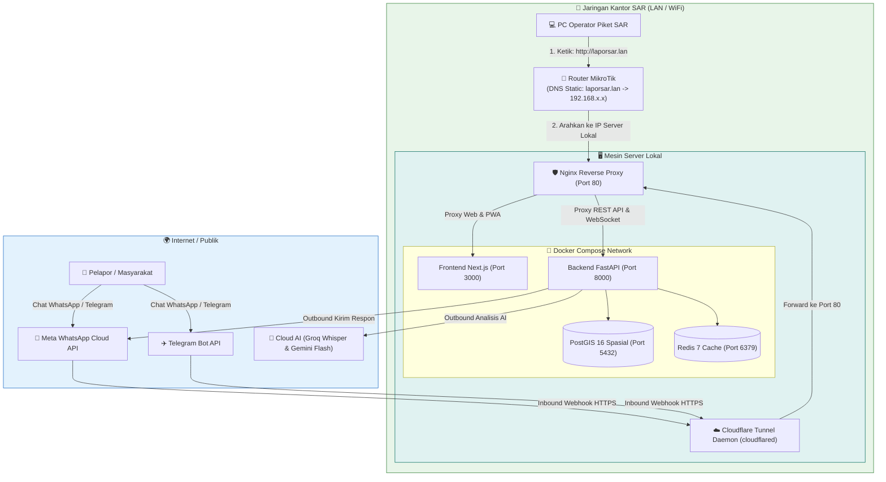

# 🗺️ Rencana Implementasi Lengkap: Lapor SAR Lite di Server Lokal (`laporsar.lan`)

Dokumen ini berisi panduan teknis dan rencana eksekusi terperinci langkah demi langkah untuk menjalankan **Lapor SAR Lite** pada sebuah **mesin server lokal kantor** menggunakan nama domain **`laporsar.lan`**, dilengkapi **Nginx Reverse Proxy**, pengaturan **DNS Statis MikroTik**, serta jembatan online **Cloudflare Tunnel** untuk WhatsApp & Telegram Bot.

---

## 🎯 Tujuan & Arsitektur Sistem

1. **Pemindahan ke Dedicated Server:** Menjalankan seluruh kontainer (PostGIS, Redis, Backend, Frontend, Nginx) di mesin server lokal khusus di kantor SAR.
2. **Kemudahan Akses Jaringan Kantor:** Seluruh PC Operator dan perangkat di jaringan kantor cukup membuka **`http://laporsar.lan`** di port standar (Port 80) tanpa perlu menghafal alamat IP atau port `:3000` / `:8000`.
3. **Bebas Masalah mDNS:** Pemilihan TLD **`.lan`** merupakan standar terbaik jaringan lokal (*RFC 6761*) yang 100% bebas dari konflik mDNS/Bonjour yang kerap terjadi pada `.local`.
4. **Konektivitas Bot Online:** Menggunakan **Cloudflare Tunnel (`cloudflared`)** sebagai jembatan aman gratis agar Meta WhatsApp Cloud API dan Telegram Bot API tetap dapat mengirim pesan masuk (*inbound webhook*) ke server lokal.



---

## ⚠️ User Review Required

> [!IMPORTANT]
> **IP Statis Server Lokal:**  
> Pastikan mesin server lokal Anda telah diatur memiliki **IP Address Statis** di jaringan kantor (misal: `192.168.88.50` atau melalui fitur *DHCP Static Lease* di MikroTik). IP ini yang akan dimasukkan ke DNS MikroTik.

> [!NOTE]
> **Koreksi Multi-Tenant Subdomain (`laporsar`):**  
> Sistem Lapor SAR memiliki fitur multi-kantor cabang (contoh: `jakarta.laporsar.lan`). Kita akan memperbarui kode agar kata **`laporsar`** dikenali sebagai nama sistem utama, sehingga otomatis masuk ke database kantor induk (**pusat**) tanpa error *404 tenant tidak ditemukan*.

---

## 🛠️ Perubahan Kode & Berkas (Proposed Changes)

### 1. Komponen Multi-Tenancy (Frontend & Backend)

#### [MODIFY] `frontend/src/middleware.ts`
Menambahkan `'laporsar'` ke daftar kata kunci yang diabaikan (*ignored subdomains*):
```diff
--- a/frontend/src/middleware.ts
+++ b/frontend/src/middleware.ts
@@ -23,1 +23,1 @@
-    const ignoredSubdomains = ['www', 'admin', 'localhost', '127', 'api'];
+    const ignoredSubdomains = ['www', 'admin', 'localhost', '127', 'api', 'laporsar'];
```

#### [MODIFY] `frontend/src/lib/api.ts`
Memastikan fungsi `getTenantSlug()` mengabaikan `'laporsar'`:
```diff
--- a/frontend/src/lib/api.ts
+++ b/frontend/src/lib/api.ts
@@ -73,2 +73,2 @@
     if (parts.length > 2) {
       const tenant = parts[0];
-      if (tenant !== 'www' && tenant !== 'admin' && !tenant.match(/^\d+$/)) {
+      if (tenant !== 'www' && tenant !== 'admin' && tenant !== 'laporsar' && !tenant.match(/^\d+$/)) {
         return tenant;
       }
     }
```

#### [MODIFY] `backend/app/db/session.py`
Menambahkan `'laporsar'` ke filter host parser backend:
```diff
--- a/backend/app/db/session.py
+++ b/backend/app/db/session.py
@@ -270,2 +270,2 @@
                 first_part = parts[0].split(":")[0]  # Remove port if present
-                if first_part not in ("www", "admin", "localhost", "127", "localhost:3000", "localhost:8000"):
+                if first_part not in ("www", "admin", "localhost", "127", "localhost:3000", "localhost:8000", "laporsar"):
                     tenant_slug = first_part
```

---

### 2. Konfigurasi Nginx Reverse Proxy

#### [NEW] `nginx/conf.d/laporsar.conf`
Membuat berkas konfigurasi Nginx untuk routing port 80:

```nginx
server {
    listen 80;
    server_name laporsar.lan localhost _;

    client_max_body_size 50M;

    # Gzip Compression untuk percepatan aset di LAN
    gzip on;
    gzip_types text/plain text/css application/json application/javascript text/xml application/xml image/svg+xml;

    # 1. Routing Frontend Next.js (Dashboard & PWA)
    location / {
        proxy_pass http://frontend:3000;
        proxy_http_version 1.1;
        proxy_set_header Upgrade $http_upgrade;
        proxy_set_header Connection 'upgrade';
        proxy_set_header Host $host;
        proxy_cache_bypass $http_upgrade;
        proxy_set_header X-Real-IP $remote_addr;
        proxy_set_header X-Forwarded-For $proxy_add_x_forwarded_for;
        proxy_set_header X-Forwarded-Proto $scheme;
    }

    # 2. Routing Backend API & WebSocket Real-time
    location /api/ {
        proxy_pass http://backend:8000/api/;
        proxy_http_version 1.1;
        proxy_set_header Upgrade $http_upgrade;
        proxy_set_header Connection "upgrade";
        proxy_set_header Host $host;
        proxy_set_header X-Real-IP $remote_addr;
        proxy_set_header X-Forwarded-For $proxy_add_x_forwarded_for;
        proxy_set_header X-Forwarded-Proto $scheme;
        proxy_read_timeout 300s;
        proxy_send_timeout 300s;
    }

    # 3. Routing Media, Foto Bukti & Voice Note
    location /uploads/ {
        proxy_pass http://backend:8000/uploads/;
        proxy_set_header Host $host;
        proxy_set_header X-Real-IP $remote_addr;
        proxy_set_header X-Forwarded-For $proxy_add_x_forwarded_for;
    }
}
```

---

### 3. Orchestrasi Docker Compose

#### [MODIFY] `docker-compose.yml`
Menambahkan service kontainer `nginx:alpine` yang mengikat port `80:80`:

```yaml
  nginx:
    image: nginx:alpine
    container_name: laporsar_lite_nginx
    restart: unless-stopped
    ports:
      - "80:80"
    volumes:
      - ./nginx/conf.d:/etc/nginx/conf.d:ro
    depends_on:
      - frontend
      - backend
    networks:
      - laporsar_lite_network
```

#### [MODIFY] `.env`
Memperbarui URL origin frontend:
```env
FRONTEND_URL=http://laporsar.lan
```

---

## 🧭 Panduan Konfigurasi di Router MikroTik

Agar seluruh PC di jaringan kantor otomatis mengenali `laporsar.lan`:

### Pilihan A: Menggunakan Winbox (GUI)
1. Buka aplikasi **Winbox**, login ke router MikroTik kantor.
2. Buka menu **IP** $\rightarrow$ **DNS**.
3. Pastikan kotak **Allow Remote Requests** tercentang (`[v]`).
4. Klik tombol **Static** (di sisi kanan).
5. Klik tombol tambah biru **[ + ]**:
   - **Name**: `laporsar.lan`
   - **Type**: `A`
   - **Address**: `[Masukkan IP Server Lokal Anda, misal: 192.168.88.50]`
   - **TTL**: `1d` (atau `01:00:00`)
6. Klik **Apply** $\rightarrow$ **OK**.

### Pilihan B: Menggunakan Terminal MikroTik (CLI)
Buka menu **New Terminal** di Winbox / SSH MikroTik, lalu jalankan satu baris perintah berikut (ganti `192.168.88.50` dengan IP Server Anda):
```routeros
/ip dns static add name="laporsar.lan" address=192.168.88.50 ttl=1d comment="Lapor SAR Local Server"
```

> [!TIP]
> **Pemeriksaan DHCP MikroTik:**  
> Pastikan di menu **IP $\rightarrow$ DHCP Server $\rightarrow$ Networks**, kolom **DNS Servers** mengarah ke IP Router MikroTik Anda (contoh `192.168.88.1`). Dengan begitu, semua PC yang terhubung ke WiFi/LAN otomatis menggunakan DNS MikroTik.

---

## ☁️ Panduan Cloudflare Tunnel untuk Webhook WhatsApp & Telegram

Agar Meta WhatsApp dan Telegram dapat mengirim pesan masuk ke server lokal Anda:

1. **Unduh `cloudflared` di Server Lokal:**
   - **Jika Server Windows:**  
     Jalankan di PowerShell: `winget install Cloudflare.cloudflared`
   - **Jika Server Linux (Debian/Ubuntu):**  
     ```bash
     curl -L --output cloudflared.deb https://github.com/cloudflare/cloudflared/releases/latest/download/cloudflared-linux-amd64.deb
     dpkg -i cloudflared.deb && rm cloudflared.deb
     ```
2. **Jalankan Tunnel Cepat:**
   ```bash
   cloudflared tunnel --url http://127.0.0.1:80
   ```
   Terminal akan menampilkan tautan HTTPS gratis, misalnya:  
   `https://rapid-rescue-xxxx.trycloudflare.com`

3. **Daftarkan Webhook:**
   - **WhatsApp (Meta Developer Portal):**
     - Callback URL: `https://rapid-rescue-xxxx.trycloudflare.com/api/whatsapp/webhook`
     - Verify Token: *(Sesuai nilai `WHATSAPP_VERIFY_TOKEN` di file .env)*
   - **Telegram Bot:**
     Buka di browser:
     `https://api.telegram.org/bot<TOKEN_BOT_ANDA>/setWebhook?url=https://rapid-rescue-xxxx.trycloudflare.com/api/telegram/webhook/pusat`

---

## 🧪 Rencana Verifikasi

### 1. Verifikasi Jaringan di PC Operator (Client)
Buka Command Prompt (CMD) di laptop/PC operator yang terhubung ke jaringan kantor:
```cmd
ping laporsar.lan
```
*Hasil yang diharapkan: Menghasilkan balasan `Reply from 192.168.88.50: bytes=32 time<1ms`.*

### 2. Verifikasi Kontainer Docker di Server
Jalankan di server:
```bash
docker compose up -d --build
docker compose ps
```
*Hasil yang diharapkan: Kelima kontainer berjalan sehat (`Up`):*
- `laporsar_lite_nginx` (Port 80)
- `laporsar_lite_frontend` (Port 3000)
- `laporsar_lite_backend` (Port 8000)
- `laporsar_lite_db` (Port 5432)
- `laporsar_lite_redis` (Port 6379)

### 3. Verifikasi Aplikasi Melalui Browser
1. Buka browser di PC operator: **`http://laporsar.lan`**
2. Login sebagai admin:
   - Username: `admin`
   - Password: `admin`
3. Pastikan Dashboard Peta, tabel laporan, dan indikator WebSocket hijau aktif.
4. Buka portal pelapor: **`http://laporsar.lan/chat`** dan lakukan uji coba pengiriman laporan.
